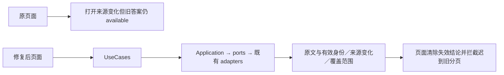

# Phone 聊天记忆与历史回忆纠偏 — 2026-10-13

配套六项后端修复及页面失效传播已完成，工程验收通过。版本 **1.0.14（1000014）**，契约 **3.12.0**，配套 ASR **0.8.1**。未部署或操作手机实机；真实 Mac、真实模型理解未验。

- Phone origin/master 基线：`7d8684d6c63718abfd3b374ba5374a582e4ddc16`。
- ASR origin/master 基线：`21fbf3c85d335f6c49e50d68c58d9d3db7fa5657`。
- 原 Phone 工作区 HEAD：`c7b6fa8b8dc7ffa60e0a38b2321e3816589314b0`，原未提交修改保留；本轮在隔离 worktree 实施。
- Mac NO CHANGE；本轮未访问，Git SHA 未核验。原有试运行范围与自动截止未操作。

## 修复范围

F1 删除故事专用事实结论，记忆使用明确标记的摘录与通用连续性候选；F2 自然问题按原话／原因／经过／后续检索；F3 证据选择保留起因、变化与最新状态候选，本地有旧命中也能按需查询后续；F4 打开原文发现变化会清除旧结论，并锁住同轮迟到分页，离线保留明确标记缓存；F5 区分 source_is_from_self 原始事实与 effective_is_self 有效身份；F6 后端通过 ports / bootstrap 组装，原架构门禁未放宽。

Phone 复用原查询与同步入口，增加 stale／覆盖不足展示；失效录音引用禁用播放。查询失败可恢复，新查询取消旧请求。没有新增人物审核系统、业务写入、模型服务或声纹改动。

## 验收与操作

- production 入口 ArkTS 编译通过（保留既有 403 条 warning）；先修复隔离 common 依赖链接，再修复 3 处 ArkTS 不支持的对象展开，未放宽编译器。
- 实际 Phone UseCases＋隔离 ASR SQLite 桥接通过：关联、重复命令、跨来源检索、解除、取消；查询不写业务 outbox。
- 页面纯状态函数通过：stale、离线、不同 query ID、迟到分页不能复活旧结论。
- 既有跨天同步、历史页 reject/link/detach、重启／旧修订重放、内容安全检查通过。历史页投影标题引发的版本冲突在后端修复；无变化版本稳定，真实变化仍生效。
- 后端相关组合 187 passed；最后修复后受影响组合 47 passed，二者重叠。固定虚构问题正确证据召回 4/8 → 8/8、入模 3/8 → 8/8。测试桩仅校验引用，真实模型理解没有测试。
- 本轮生产原文／目录／业务元数据读取均 0；真实模型调用 0；Mac 请求 0；设备操作 0。私有配置、数据库、正文、模型回执和构建签名材料不入 Git。

部署配套版本后，从原「人物」页或录音列表进入「历史检索与回忆」，输入问题并选人物／来源／日期；按需核对来源可找到后续。点依据核对原文；出现来源修订提示时重新查询。人物关联／拒绝／解除仍在「选择人物／查看来源身份」。本轮无需用户额外聊天或操作设备。

详细六项说明、固定语料哈希、耗时、复现命令和已知限制见配套 ASR `RESULT.md`。语义同义召回与预算外远处后续仍有限；引用校验不能证明任意模型归纳正确。本地审核包仅含代码差异、虚构样例和必要日志，供 ChatGPT 独立审核，未宣称独立审核已完成。
